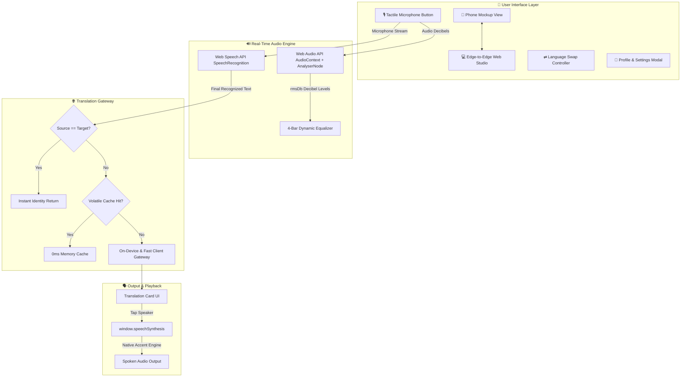

<div align="center">

# 🎙️ VaaniSnap Web

### **Live Voice Translation & Official Android Publishing Platform**
*Speak freely. Understand each other.*

[](https://baanisnap-web-v005.vercel.app/)
[](https://vitejs.dev/)
[](https://developer.mozilla.org/en-US/docs/Web/JavaScript)
[](https://developer.mozilla.org/en-US/docs/Web/CSS)
[](https://developer.mozilla.org/en-US/docs/Web/API/Web_Speech_API)
[](https://github.com/Arko-009/VaaniSnap--Live-Translation)
[](#-privacy-first-philosophy)
[](LICENSE)

<br/>

[🚀 Live Web App (Vercel)](https://baanisnap-web-v005.vercel.app/) •
[✨ Key Features](#-key-features) •
[⚙️ System Architecture](#-system-architecture) •
[🌍 Supported Languages](#-supported-languages) •
[📥 Download Android APK](#-downloading-the-android-app)

---

</div>

## 📖 Overview

**VaaniSnap Web** is an end-to-end browser recreation and official distribution platform for the [VaaniSnap Android Live Voice Translator](https://github.com/Arko-009/VaaniSnap--Live-Translation). 

It fulfills two critical roles:
1. **Interactive In-Browser Application Studio**: Experience the entire Android native voice translation workflow right in your browser with real-time speech-to-text, live decibel audio animations, instant translation, and native accent voice playback.
2. **Official App Distribution & Showcase Portal**: An official product launch landing page with technical architecture diagrams, an interactive 7-language matrix, direct APK download, and Google Drive cloud mirrors.

---

## ✨ Key Features

- 🎙️ **Real-Time Speech Recognition**  
  Built with the browser platform **Web Speech API** (`SpeechRecognition` / `webkitSpeechRecognition`). Words stream live into the conversation card as you speak with point-of-use microphone permission safety.
- 📊 **Live Vocal Decibel Response (`rmsDb`)**  
  Uses the **Web Audio API** (`AudioContext` + `AnalyserNode`) to calculate real-time vocal volume, dynamically animating the 4-bar equalizer just like Android's native `AudioBarsAnimation`.
- 🌐 **Multi-Tier Privacy-First Translation Gateway**  
  High-resilience client translation pipeline with instant identity return for identical language pairs, memory caching, and curated travel/medical offline phrase dictionaries.
- 🔊 **Native Voice Playback (TTS)**  
  Leverages `window.speechSynthesis` to speak translated sentences aloud with native regional pronunciation. Features real-time utterance state tracking with an interactive Play/Stop toggle.
- ⇄ **Instant Bidirectional Swap**  
  Seamlessly inverts source and target languages with a single tap. The active translated response automatically flips into the source position and re-translates without requiring you to speak again.
- 📱 **Dual-Mode Experience (Phone Mockup vs. Edge-to-Edge Web)**  
  Switch instantly between an authentic **Android 15 Phone Mockup** (complete with status bar, punch-hole camera, and glass reflections) and an adaptive **Full Web App Studio** view.
- 🔒 **100% Volatile RAM & Privacy by Design**  
  Zero database, zero analytics tracking, zero persistent disk logging. All spoken audio and transcribed sentences exist exclusively in ephemeral memory and vanish when you close or refresh the session.
- 📥 **Dual-Option APK Distribution Hub**  
  Offers visitors one-click direct APK downloads served from local storage, alongside a fast Google Drive cloud mirror.

---

## ⚡ Quickstart & Terminal Commands

Follow these simple step-by-step commands in your terminal to clone, install, and run the project locally.

### Prerequisites

- **Node.js**: `v18.0.0` or newer installed ([Download Node.js](https://nodejs.org/))
- **NPM**: `v9.0.0` or newer (comes bundled with Node.js)
- **Modern Web Browser**: Google Chrome, Microsoft Edge, Brave, or Safari (supporting the Web Speech API)

---

### Step 1: Clone the Repository

Open your terminal or PowerShell and run:

```bash
git clone https://github.com/Arko-009/VaaniSnap-Web-v0.05.git
```

---

### Step 2: Navigate to Project Directory

```bash
cd VaaniSnap-Web-v0.05
```

---

### Step 3: Install Dependencies

Install the lightweight Vite development dependencies:

```bash
npm install
```

---

### Step 4: Start the Development Server

Launch the local development server:

```bash
npm run dev
```

You will see output similar to:
```text
  VITE v5.4.x  ready in 300 ms

  ➜  Local:   http://localhost:3000/
  ➜  Network: http://192.168.x.x:3000/
```

---

### Step 5: Open in Your Browser

Open your browser and navigate to:
```
http://localhost:3000/
```

> **Microphone Permission Tip:** When prompted by your browser, click **"Allow"** to enable the microphone for speech recognition. You can also use the **Quick Test Phrases** chips or the **"Type Text ⌨️"** drawer to test translation without speaking!

---

### Additional Production Commands

#### Build Production Bundle:
Compiles and minifies HTML, CSS, and JS into the `dist/` directory:
```bash
npm run build
```

#### Preview Production Build:
Starts a local web server serving the compiled `dist/` directory:
```bash
npm run preview
```

---

## 📥 Downloading the Android App

VaaniSnap is also available as a native Android app (API 26+). From the web interface or terminal, you have two download channels:

### 1. Direct Download
Click the **"Download APK Directly (83 MB)"** button inside the download modal, or access directly in your browser:
```
http://localhost:3000/downloads/BaaniSnap-LiveTranslatorV.0.05.apk
```
*(Also aliased to `/downloads/VaaniSnap.apk`)*

### 2. Google Drive Mirror
Download directly from our verified cloud mirror:  
🔗 [**Google Drive Download Link**](https://drive.google.com/file/d/1Lc_FuMg5efUoON0vadqALyLPibHE_ZKy/view?usp=drive_link)

### 3. Install to Device via ADB

```bash
# Connect phone via USB with USB Debugging enabled:
adb install -r public/downloads/BaaniSnap-LiveTranslatorV.0.05.apk

# Launch the app immediately:
adb shell am start -n com.vaanisnap.app/.MainActivity
```

---

## ⚙️ System Architecture



---

## 🌍 Supported Languages

VaaniSnap supports **7 major global and regional languages** with bidirectional voice translation and native speech synthesis:

| Flag | Language | Region | Locale Code | Speech Recognition | Translation | Voice Output (TTS) |
| :---: | :--- | :--- | :---: | :---: | :---: | :---: |
| 🇺🇸 | **English** | United States | `en-US` | ✅ | ✅ Bidirectional | ✅ Native |
| 🇮🇳 | **Hindi (हिन्दी)** | India | `hi-IN` | ✅ | ✅ Bidirectional | ✅ Native |
| 🇮🇳 | **Bengali (বাংলা)** | India / BD | `bn-IN` | ✅ | ✅ Bidirectional | ✅ Native |
| 🇪🇸 | **Spanish (Español)** | Spain | `es-ES` | ✅ | ✅ Bidirectional | ✅ Native |
| 🇫🇷 | **French (Français)** | France | `fr-FR` | ✅ | ✅ Bidirectional | ✅ Native |
| 🇯🇵 | **Japanese (日本語)** | Japan | `ja-JP` | ✅ | ✅ Bidirectional | ✅ Native |
| 🇸🇦 | **Arabic (العربية)** | Saudi Arabia | `ar-SA` | ✅ | ✅ Bidirectional | ✅ Native |

---

## 🗂️ Project Directory Structure

```
VaaniSnap-Web-v0.05/
├── index.html                   # Core HTML5 semantic entry & publishing layout
├── package.json                 # Project scripts and Vite configuration
├── README.md                    # Comprehensive documentation & setup guide
├── public/
│   ├── favicon.svg              # Brand soundwave gradient favicon
│   ├── app-icon.svg             # Vector brand artwork
│   └── downloads/
│       └── VaaniSnap.apk        # APK binary distribution package
└── src/
    ├── main.js                  # Application bootstrapper
    ├── style.css                # Material 3 & Jetpack Compose design tokens
    ├── model/
    │   └── languages.js         # Supported languages, SVG flags & phrase bank
    ├── speech/
    │   └── speechRecognizer.js  # Web Speech API + Web Audio decibel analyzer
    ├── translation/
    │   └── translationGateway.js# Multi-tier translation pipeline & volatile cache
    ├── tts/
    │   └── textToSpeechGateway.js# SpeechSynthesis engine & voice matcher
    └── ui/
        ├── appController.js     # State machine for the Jetpack Compose app replica
        └── publishingController.js# Phone/Web mode toggle, download modal & matrix
```

---

## 🔒 Privacy-First Philosophy

- **Zero Cloud Audio Streaming**: Your voice is processed directly on your device via built-in browser engine APIs.
- **Volatile Memory Only**: All spoken text and translation results exist solely in volatile RAM. No databases, no tracking cookies, and no disk logging.
- **Transparent Open Source**: Completely open and auditable under the Apache 2.0 license.

---

## 🤝 Related Repositories

- **Android App Repository**: [Arko-009 / VaaniSnap--Live-Translation](https://github.com/Arko-009/VaaniSnap--Live-Translation) — Native Kotlin & Jetpack Compose application powered by on-device Google ML Kit.

---

## 📄 License

This project is open-source software licensed under the **[Apache License 2.0](LICENSE)**.

<div align="center">
<br/>
Crafted with ❤️ for open, accessible, and private human communication.
<br/>
<b>VaaniSnap — Let Every Voice Be Understood.</b>
</div>
